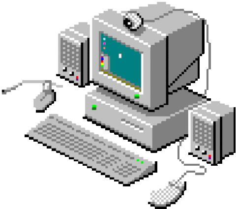
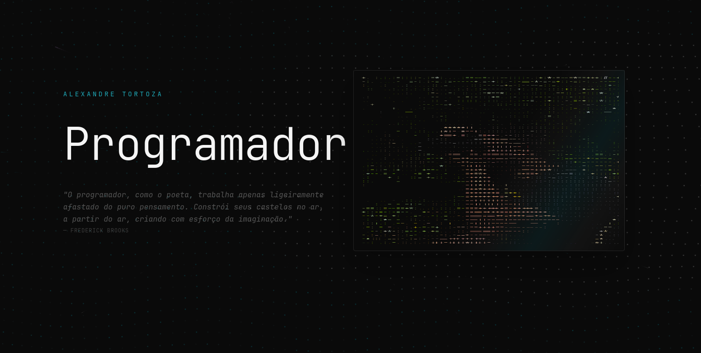
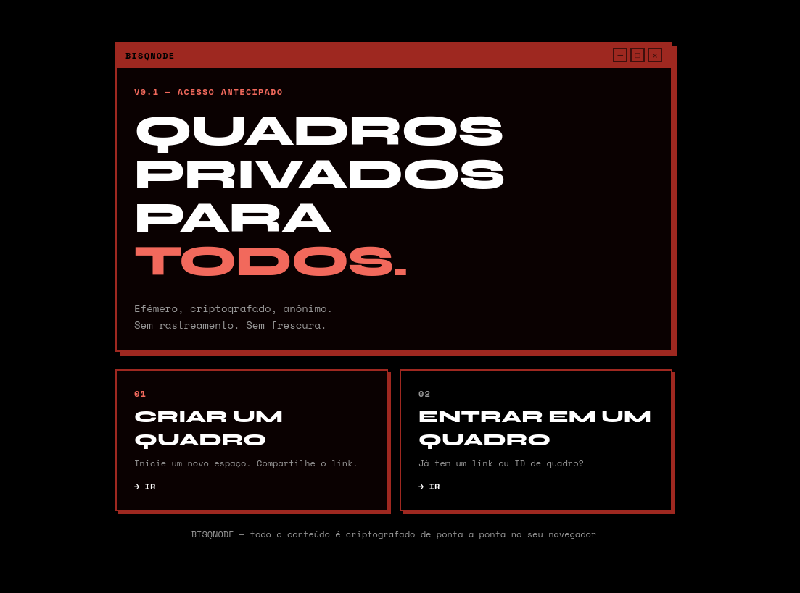

<div align="center">
  <small>
    <a href="https://github.com/Alexandre-Tortoza/Alexandre-Tortoza/blob/main/README-ptbr.md">Português</a> ·
    <a href="https://github.com/Alexandre-Tortoza/Alexandre-Tortoza/blob/main/README.md">English</a>
  </small>
</div>
<div align="center">
  

  [](https://git.io/typing-svg)

  [](https://git.io/typing-svg)
</div>

<div align="center">
  <!-- Frontend -->
  
  
  
  
  
  
  
  
  
  
  
  
  <!-- Build tools, testing and package managers -->
  
  
  
  
  
  <!-- Backend -->
  
  
  
  
  
  
  
  
  <!-- Python and Machine Learning -->
  
  
  <!-- Databases, caching and ORM -->
  
  
  
  
  
  
  <!-- Version control and CI/CD -->
  
  
  
  
  <!-- Infrastructure and hosting -->
  
  
  
  
  
  <!-- Development environment -->
  
  
  
  
  
</div>

---

```bash
[root@alexmrtr ~]# fastfetch
```

```txt

  ██████████████████████████████████████████████████████      ┌──────────────────────Hardware──────────────────────┐
  ██████████████████████████████████████████████████████       PC: 730QFG (P05VAE)
  ████                     ████                     ████      │ ├: 13th Gen Intel(R) Core(TM) i5-1335U (4+8) @ 4.60 GHz
  ████                     ████                     ████      │ ├: Iris Xe Graphics
  ████    █████████████████████         ████████    ████      │ ├󱄄: 1920x1080 @ 1.59x in 13", 60 Hz [Built-in]
  ████    █████████████████████         ████████    ████      │ ├󰋊: 113.66 GiB / 236.46 GiB (48%) - btrfs
  ████    ████                              ████    ████      │ ├: 5.04 GiB / 7.44 GiB (68%)
  ████    ████                              ████    ████      └ └󰓡: 978.03 MiB / 14.88 GiB (6%)
  ████    ████                              ████    ████      └────────────────────────────────────────────────────┘
  ████    ████                              ████    ████
  ████    ████                              ████    ████      ┌──────────────────────Software──────────────────────┐
  ████    ████                              ████    ████       OS: Omarchy 4.5.0-3
  ████████████                              ████    ████      │ ├󰔫: stable
  ████████████                              ████    ████      │ ├: Linux 7.2.15-1-omarchy
  ████    ████                              ████    ████      │ ├: Hyprland 0.56.2 (Wayland)
  ████    ████                              ████    ████      │ ├: ghostty 1.4.0+omarchy.1
  ████    ████                              ████    ████      │ ├󰏖: 1158 (pacman)
  ████    ████                              ████    ████      │ ├󰸌: Event Horizon ●●●●●●●●
  ████    ████                              ████    ████      └ └: FiraCode Nerd Font Mono (8pt)
  ████    ████                              ████    ████      └────────────────────────────────────────────────────┘
  ████    ██████████████████████████████████████    ████
  ████    ██████████████████████████████████████    ████      ┌────────────────Age / Uptime / Update───────────────┐
  ████                     ████                     ████      󱦟 OS Age: 51 days
  ████                     ████                     ████      󱫐 Uptime: 1h 24m
  █████████████████████████████     ████████████████████       Update: Friday 06 November 2026 at 18:55
  █████████████████████████████     ████████████████████      └────────────────────────────────────────────────────┘
```

<br/>

```bash
[root@alexmrtr ~]# cat status
```

<div align="center">

[](https://github.com/Alexandre-Tortoza)

</div>

<div align="center">

[](https://github.com/alexandre-tortoza)&nbsp;&nbsp;[](https://github.com/alexandre-tortoza)

</div>

<br/>

```bash
[root@alexmrtr ~]# ls ~/projects
```

<table>
  <tr>
    <td width="50%" valign="top"> <h3 align="center">alexmrtr</h3>
  <a href="https://github.com/Alexandre-Tortoza/alexmrtr">
    
  </a>

  <p>
  A small corner of the internet where code, motion, and creativity come together. Built to explore ideas, share projects, and tell stories through thoughtful interactions, playful animations, and a love for crafting experiences on the web.
  </p>

  <p>
    <code>Astro</code>
    <code>TypeScript</code>
    <code>Tailwind CSS</code>
    <code>Three.js</code>
    <code>GSAP</code>
  </p>

  <p>
    <a href="https://github.com/Alexandre-Tortoza/alexmrtr">
      
    </a>
    <a href="https://alexandre-tortoza.tech">

    </a>
  </p>
</td>

<td width="50%" valign="top">
  <h3 align="center">BisqNote</h3>

  <a href="https://github.com/Alexandre-Tortoza/bisqnote">
    
  </a>

  <p>
A privacy-first collaborative board built for practice and real-world use. Features end-to-end encryption with kanban, calendar, chat, and file sharing to explore secure teamwork experiences.
  </p>

  <p>
    <code>Vue 3</code>
    <code>Fastify</code>
    <code>TypeScript</code>
    <code>PostgreSQL</code>
    <code>Drizzle</code>
  </p>

  <p>
    <a href="https://github.com/Alexandre-Tortoza/bisqnote">
      
    </a>
  </p>
</td>
</tr>
</table>

<br/>

```bash
[root@alexmrtr ~]# nvim
```

<div align="center">

[](https://leetcode.com/u/alexandre-tortoza/)


</div>

<br/>

```bash
[root@alexmrtr ~]# contact --info
```

<div align="center">

[](mailto:alexandre.tortoza@proton.me)
[](https://alexandre-tortoza.tech)
[](https://linkedin.com/in/alexmrqr)

</div>

<div align="center">
  
  <small>
    Building things with lots of ☕
  </small>
  
</div>
